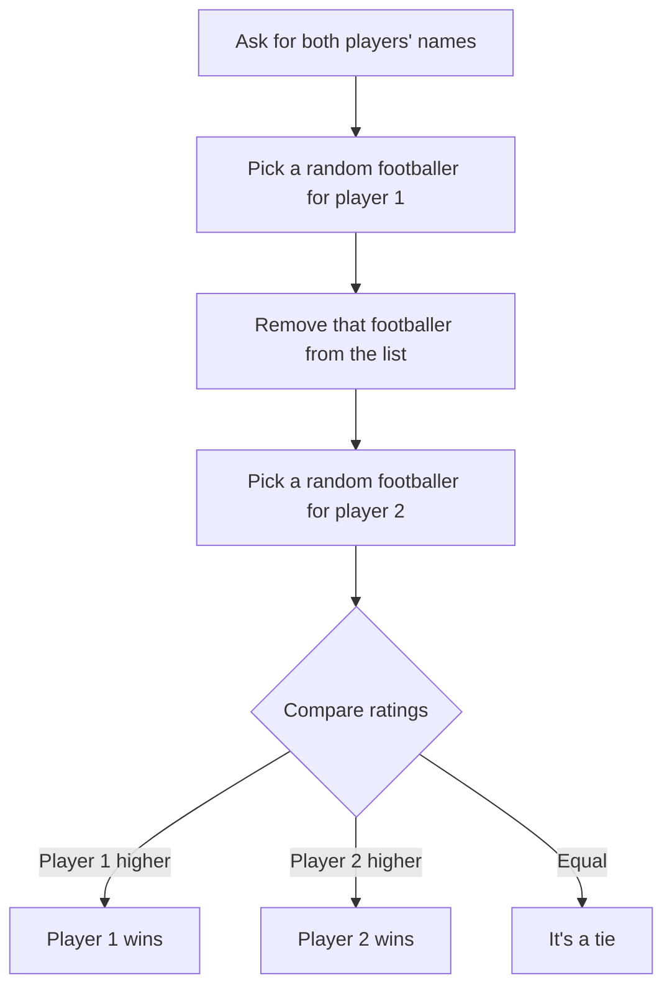
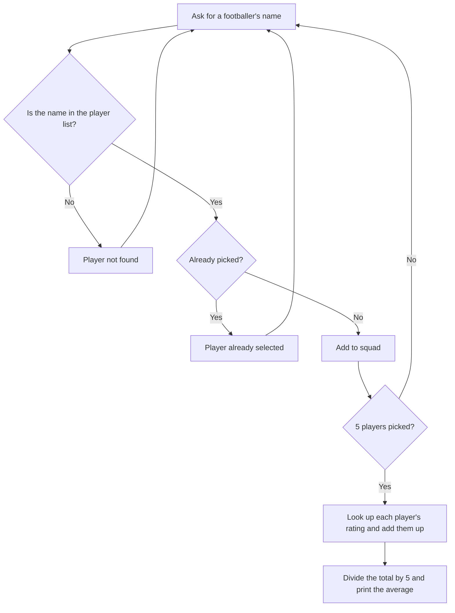
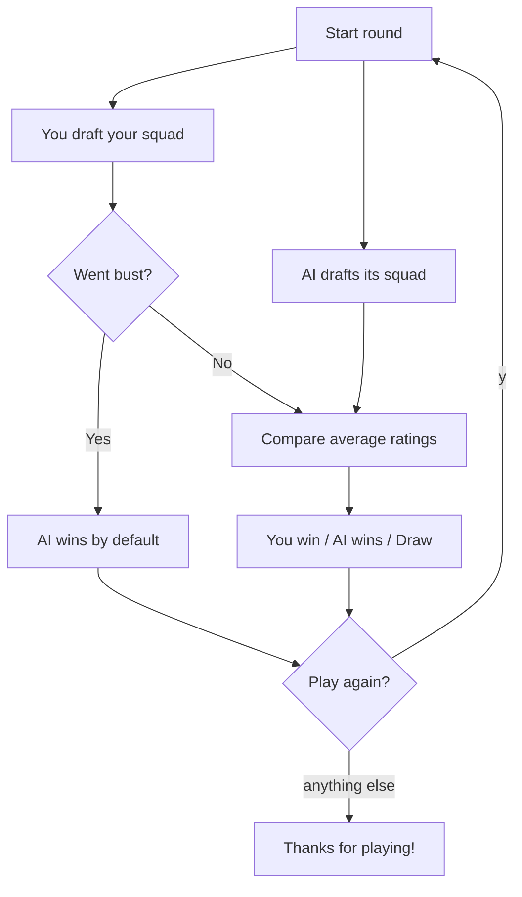

# ⚽ Football Player Generator


A collection of three football-themed terminal games written in pure Python. They share a pool of footballers, each with a name and a rating. The games get more complex as you go: a simple random head-to-head, then a squad-rating calculator, then a full fantasy draft against a computer opponent with a budget to manage.

---

## 📋 Table of Contents

- [The Games at a Glance](#-the-games-at-a-glance)
- [Getting Started](#-getting-started)
- [Game 1: Random Footballer Battle](#game-1-random-footballer-battle)
- [Game 2: Squad Average Rating Calculator](#game-2-squad-average-rating-calculator)
- [Game 3: Fantasy Draft vs AI](#game-3-fantasy-draft-vs-ai)
- [How the Player Data Is Stored](#-how-the-player-data-is-stored)
- [Project Structure](#-project-structure)
- [What I Learned](#-what-i-learned)
- [Roadmap](#%EF%B8%8F-roadmap)
- [Author](#-author)

---

## 🎯 The Games at a Glance

| Game | File | Players | What it shows |
|---|---|---|---|
| **Random Footballer Battle** | `randomfootballgeneratorgame.py` | 2 people | Random selection, comparing values, `if / elif / else` |
| **Squad Average Rating** | `averagefootballerratinggenerator.py` | 1 person | Input validation, loops, searching data, calculating an average |
| **Fantasy Draft vs AI** | `claudecodefantasyfootball.py` | 1 person vs computer | Functions, budget management, a computer opponent, replay loop |

---

## 🚀 Getting Started

### Prerequisites

- [Python 3](https://www.python.org/downloads/)
- No external libraries needed. Only Python's built-in `random` module is used.

### Installation

```bash
git clone https://github.com/varshansasikumar73/football---player--generator.git
cd football---player--generator
```

Each game is a standalone script, so run whichever one you want:

```bash
python3 randomfootballgeneratorgame.py
python3 averagefootballerratinggenerator.py
python3 claudecodefantasyfootball.py
```

---

## Game 1: Random Footballer Battle

**File:** `randomfootballgeneratorgame.py`

Two people enter their names, and each is given a random footballer. Whoever gets the footballer with the higher rating wins.

### Demo

```
Enter the name of player 1: Sam
Enter the name of player 2: Alex
Sam:selected Mbappe with a rating of 98
Alex:selected Stiff Bucko with a rating of 100
Alex wins with Stiff Bucko
```

### How it works



| Step | Code | Why |
|---|---|---|
| **Random pick** | `random.choice(players)` | Picks one footballer at random from the list |
| **No duplicates** | `players.remove(player_1)` | Removes player 1's footballer before player 2 picks, so both people can't get the same one |
| **Deciding the winner** | `if / elif / else` on `["rating"]` | Compares the two ratings and handles a tie. Ties can happen because different footballers can share a rating (e.g. Neymar and Haaland are both 96) |

---

## Game 2: Squad Average Rating Calculator

**File:** `averagefootballerratinggenerator.py`

Pick 5 footballers by name to build a squad, and the program works out the squad's average rating.

### Demo

```
Enter the name of footballer 1: Messi
Enter the name of footballer 2: messi
Player not found. Please enter a valid player name.
Enter the name of footballer 2: Haaland
Enter the name of footballer 3: Messi
Player already selected. Please choose a different player.
Enter the name of footballer 3: Rodri
Enter the name of footballer 4: Sithole
Enter the name of footballer 5: Jan Oblak
Your average player rating is: 86.8
```

### How it works



| Step | Code | Why |
|---|---|---|
| **Checking the name exists** | `[player["name"] for player in players]` | A list comprehension builds a list of every name, and `not in` checks whether the input is one of them |
| **Stopping duplicates** | `elif name_ofplayer1 in selected_players` | Checks the squad so far, so the same footballer can't be picked twice |
| **Retrying bad input** | `continue` | Skips back to the top of the loop **without** increasing the count, so the player is asked again for the same slot |
| **Counting picks** | `while count < 5` | The count only goes up after a valid pick, so the loop always ends with exactly 5 players |
| **Adding up ratings** | Nested `for` loops | For each picked name, searches the full player list for the matching dictionary and adds its rating to the total |
| **The average** | `total / 5` | Divides the combined rating by the squad size |

> **Note:** names must be typed exactly as they appear in the list, including capital letters (`Messi` works, `messi` doesn't).

---

## Game 3: Fantasy Draft vs AI

**File:** `claudecodefantasyfootball.py`

The most advanced game in the project. You have **£500m** to build a squad of **5 footballers**, and a computer opponent drafts its own squad with the same budget. The squad with the higher average rating wins.

### The catch: the budget

Every footballer's price depends on their rating:

```python
player["cost"] = round(player["rating"] * 1.2)
```

So better players cost more. Messi (99) costs £119m, but Sithole (62) costs £74m. You can't afford five superstars: £500m over 5 players only gives you about £100m each. You have to decide whether to spend big on a couple of stars and fill the rest cheaply, or spread the money evenly. If you overspend early and can't afford anyone else, **you go bust and lose automatically**.

### Demo

```
=== Fantasy Draft ===

You have £500m to build a squad of 5 players.

#  Name                    Rating  Cost
1  Messi                   99      119
2  Ronaldo                 97      116
3  Neymar                  96      115
...

Budget remaining: £500m | Players picked: 0/5
Pick a player (name or number): Sithole
...
Budget remaining: £131m | Players picked: 4/5
Pick a player (name or number): 99
Player not found. Try again.
...
Pick a player (name or number): Casemiro

Your squad (5/5):
  Sithole (rating 62, cost £74m)
  Enzo Fernandez (rating 78, cost £94m)
  Djed Spence (rating 83, cost £100m)
  Frenkie de Jong (rating 84, cost £101m)
  Casemiro (rating 85, cost £102m)
  Average rating: 78.4

AI's squad:
  Stiff Bucko (rating 100, cost £120m)
  Joshua Kimmich (rating 90, cost £108m)
  Sithole (rating 62, cost £74m)
  Enzo Fernandez (rating 78, cost £94m)
  Djed Spence (rating 83, cost £100m)
  Average rating: 82.6

AI wins. 82.6 vs 78.4

Play again? (y/n): n
Thanks for playing!
```

### Game flow



### The functions

This game is split into small functions, each with one job:

| Function | What it does |
|---|---|
| `display_pool(pool)` | Prints the available footballers as a numbered table with lined-up columns |
| `find_player(pool, choice)` | Finds a footballer by **number** or by **name** (capital letters don't matter). Returns `None` if there's no match |
| `user_draft(pool)` | Runs your draft: shows the table, checks the budget, adds picks, and spots when you've gone bust |
| `ai_draft(pool)` | Runs the computer's draft (explained below) |
| `average_rating(squad)` | Adds up a squad's ratings and divides by the number of players |
| `print_squad(title, squad)` | Prints a squad with each player's rating and cost, plus the average |
| `play_round()` | Runs one full round: both drafts, the results, and the winner |
| `main()` | Shows the title and keeps starting new rounds until you choose to stop |

### Key techniques

**1. Picking by name or number.** `find_player()` accepts either input:

```python
if choice.isdigit():          # "3" → look it up by position
    index = int(choice) - 1
    ...
for player in pool:           # "messi" → look it up by name
    if player["name"].lower() == choice.lower():
```

`.isdigit()` checks whether the input is a number. It also checks the number is in range, so an input like `99` is rejected. `.lower()` on both sides means `messi`, `Messi` and `MESSI` all work.

**2. Detecting when you've gone bust.** Before every pick, the game checks whether you can afford **anyone** left:

```python
if all(player["cost"] > budget_left for player in pool):
```

`all()` returns `True` only if every remaining footballer costs more than you have left. If so, the draft ends early.

**3. The AI opponent.** The computer shuffles the footballers into a random order and goes through them one by one. It picks the first footballer that passes this check:

> *"If I buy this player, will I still have enough money left to fill my remaining slots with the cheapest players available?"*

```python
others = sorted((p for p in candidates if p is not player), key=lambda p: p["cost"])
reserve = sum(p["cost"] for p in others[:slots_after])
if player["cost"] + reserve <= budget_left:
    picked = player
```

- `sorted(..., key=lambda p: p["cost"])` sorts the other footballers from cheapest to most expensive.
- `others[:slots_after]` takes the cheapest few, one for each slot still to fill.
- `reserve` is the minimum the AI must keep back to complete its squad.

So the AI makes random picks, but it **never goes bust**, and each game it drafts a different squad.

**4. Keeping each round fresh.** Each draft gets its own copy of the player list:

```python
user_draft([p.copy() for p in PLAYERS])
ai_draft([p.copy() for p in PLAYERS])
```

Footballers are removed from the pool as they're picked. Working on copies means the original `PLAYERS` list never changes, so every new round starts with the full list. The AI also drafts from its own copy, which is why both squads can include the same footballer.

**5. Constants.** `BUDGET = 500` and `SQUAD_SIZE = 5` are written in capitals at the top of the file. This is a Python convention for values that shouldn't change. To change the rules, you only need to edit one line.

**6. The `if __name__ == "__main__":` guard.** This runs `main()` only when the file is run directly, so another script could import its functions without starting a game.

---

## 🗂️ How the Player Data Is Stored

All three games store footballers as a **list of dictionaries**. Each dictionary holds one footballer's details:

```python
players = [
    {"name": "Messi", "rating": 99},
    {"name": "Ronaldo", "rating": 97},
    ...
]
```

The fantasy draft game adds a `cost` to each footballer when it starts:

```python
{"name": "Messi", "rating": 99, "cost": 119}
```

Dictionaries let the code read a value by name (`player["rating"]`) instead of remembering what position it's in. That makes the code easier to read.

---

## 📁 Project Structure

```
football---player--generator/
├── randomfootballgeneratorgame.py       # Game 1: random head-to-head
├── averagefootballerratinggenerator.py  # Game 2: squad average calculator
├── claudecodefantasyfootball.py         # Game 3: fantasy draft vs AI
└── README.md                            # Project documentation
```

---

## 🧠 What I Learned

- **Data structures**: using a list of dictionaries to store structured data, and reading values by key
- **Randomness**: `random.choice()` to pick an item and `random.shuffle()` to randomise an order
- **Input validation**: rejecting unknown or repeated names, and using `continue` to ask again
- **Searching data**: list comprehensions and loops to find a footballer by name or position
- **Functions**: splitting a larger program into small, single-purpose functions
- **Built-in functions**: `all()`, `sum()`, `sorted()`, `enumerate()` and `round()`
- **Lambda functions**: using `key=lambda p: p["cost"]` to sort dictionaries by one value
- **Copying data**: why changing a list inside a function can affect the original, and using `.copy()` to prevent it
- **Building a simple AI**: random choice combined with a rule that stops the AI from going bust
- **Formatting output**: f-string alignment (`:<24`) for tables, and `:.1f` to round to one decimal place

---

## 🗺️ Roadmap

Ideas for future versions:

- [ ] Load footballers from a shared file (e.g. CSV or JSON) instead of repeating the list in each script
- [ ] Combine all three games into one menu
- [ ] Make Game 2 accept names regardless of capital letters
- [ ] Add positions (goalkeeper, defender, etc.) and require a balanced squad in the fantasy draft
- [ ] A smarter AI that tries to maximise its average rating within the budget

---

## 👤 Author

**[@varshansasikumar73](https://github.com/varshansasikumar73)**

If you have feedback or suggestions, feel free to open an issue!
